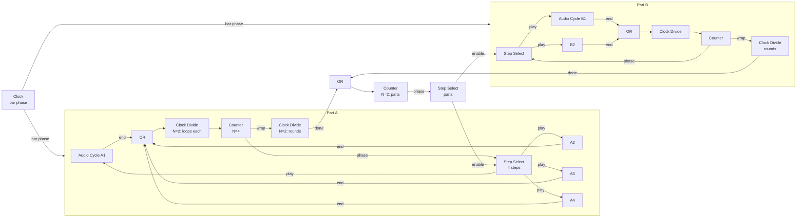

# ADR-0012: Arrangement from phase-driven primitives

- **Status:** Proposed
- **Date:** 2026-10-15
- **Related requirements:** FR-LIB-16, FR-LIB-19 to FR-LIB-22, FR-LIB-24, FR-ENCAP-*, FR-SIG-04, FR-SIG-06
- **Related decisions:** ADR-0002 (feedback), ADR-0007 (signals), ADR-0011 (everything is a module)

## Context

This is one of the main reasons LoomDSP exists.

Bitwig Studio's clip launcher plays clips with "next actions": play the next clip, a random one, and so on. But it cannot express arrangements such as:

> Play the loops of group A round robin, each loop twice. When group A has done this twice, play group B the same way. Then return to A, or go somewhere else.

The clip launcher's logic is fixed. It cannot count rounds, it cannot chain groups by rules, and it lives outside the Grid, so modulation and logic cannot drive it.

ADR-0011 decided that arrangement is made of modules, with no timeline. This ADR decides *which* modules, and how they fit the signal model (ADR-0007): timing is phase, events are gates and triggers.

Bitwig's Grid already shows the right primitives, outside its clip launcher ([Grid modules](https://www.bitwig.com/userguide/latest/grid_modules/)):

- **Ø Counter** (Phase category) "translates successive trigger signals into discrete phase values".
- **Clock Divide** (Logic category) "fires once every N clock pulses".
- **N-Latch** "lets triggers cycle through multiple output states".
- Its Data modules are sequencers *read by a phase signal*.

The key idea: when a counter outputs a **phase**, a step sequencer can read it. So "rotate through loopers" is a step sequencer whose steps are loopers. And the same pair, one level up, sequences whole parts.

A second goal is the right level of abstraction. Pure Data shows that pure primitives are powerful but slow to work with. Fixed devices are quick but closed. We want users to work close to their musical ideas, and still be able to open everything up. MNodes is a useful reference for the "graph becomes an instrument" direction: its projects become playable instruments with their own interfaces, and users share them through a hub ([MNodes](https://marionietoworld.com/mnodes/)).

## Decision (proposed)

Arrangement is built from five phase-driven primitives. Groups, parts, and song structure are **built-in abstractions** made from those primitives, shipped as open patches that users can use as one module or open and change.

### The primitives

| Module | Inputs | Outputs | Behaviour |
|---|---|---|---|
| **Note Cycle** | bar phase, play (gate) | pitch, gate, velocity, end (trigger) | Plays a stored note pattern that is *length* bars long. Mono first; polyphony follows OQ-16. |
| **Audio Cycle** | bar phase, play (gate) | left, right, end (trigger) | Plays a stored audio loop that is *length* bars long. Fades over a few milliseconds when play changes, to avoid clicks. Recording comes with OQ-15. |
| **Clock Divide** | trigger, reset | trigger | Fires on every Nth incoming trigger. "Loop twice, then move on." |
| **Counter** | trigger, reset | phase, wrap (trigger) | Counts triggers from 0 to N-1. Phase output is count ÷ N, so a phase-reading module can follow it. Wrap fires when the count returns to 0. |
| **Step Select** | phase, enable (gate) | N gates | Exactly one output is high: the step that the phase points at. All outputs are low while enable is low. A step sequencer whose steps are "which module plays". |

Rules that make them compose:

1. **Cycles read the clock's bar phase, not their own clock.** Length in bars is a parameter. Every cycle follows the same clock, so they stay in sync, change tempo together, and never drift.
2. **Restart or join.** A cycle counts bar wraps internally to know where it is in its loop. In *restart* mode (the default), it starts from its beginning when play goes high. In *join* mode, it keeps counting while stopped, so it enters in step with the global bar position. Restart is what rotation needs; join is what layered loops need.
3. **End fires only while playing.** So the end outputs of a whole group can be combined with an OR, and only the cycle that is playing advances the count.
4. **Every switch happens on a loop boundary.** Switching is driven by end triggers, which come at the end of a loop. No separate quantise step is needed for patched logic. Manual triggers (a pad, a button) go through a clock quantiser first (FR-LIB-16).
5. **Location does not matter.** Play inputs are ordinary gates. Rotation works through cables, so loopers do not need to be next to each other on the canvas.

### Worked example

"Play group A round robin, each loop twice. After two rounds, play group B the same way. Then back to A."

The song level is the same pair of primitives as the part level: a counter driving a selector. Arrangement becomes a step sequencer of step sequencers. Other rules are ordinary patching: a random part, part B only every third time, a MIDI pad that forces the next part.

When a part becomes active, its counter is reset (the rising edge of its enable), so the part always starts from its first loop.

### Three layers of abstraction

1. **Primitives** (above, plus logic such as OR, AND, compare). Always available, for people who want their own rules.
2. **Built-in abstractions**, shipped as patches made from primitives: *Looper Group* (N cycles with rotation and a "round done" output), *Part*, and *Song Sequencer*. They work like any module, show a small view of what is playing, and open up for learning or changing. This is how Reaktor's macros and Max's abstractions work.
3. **Panels** on top, for performance (FR-PANEL-*).

User abstractions use exactly the same format as built-in ones. Saved and shared, they grow the library (FR-SHARE-*).

## Options considered

1. **A fixed clip launcher with next actions**, as in Bitwig. Familiar and quick. Rejected: its logic is closed, which is the limit this project exists to remove.
2. **A "Group" module with built-in next-action modes** (round robin, random, sequential). Quick to use, but every new rule needs a new mode, and the logic cannot be patched. Kept only as a built-in abstraction made from primitives (layer 2), so it stays open.
3. **Phase-driven primitives plus open abstractions** (chosen). One mental model at every level, the same signal rules as everything else, and no special cases in the engine.

## Consequences

- **Module data comes first.** Cycles store patterns and audio. They need FR-LIB-19 (OQ-17), planned for P2.
- **Encapsulation makes it usable.** Without sub-patches, the worked example is about 30 tiles. With them, Part A is one tile with a "start" input, a "done" output, and a view of the current loop (FR-ENCAP-*, P2).
- **Triggers need a convention** (OQ-19). Gates are defined (high above 0.5), triggers are not. Counters count rising edges, so the length of a trigger pulse matters for display and for chaining.
- **Arrangement loops are feedback loops.** End → counter → select → play forms a cycle in the graph. The compiler handles it (ADR-0002): it inserts a one-sample delay and runs the loop one sample at a time. The modules involved are cheap, but an Audio Cycle inside such a loop also runs per sample. Measure this in P3, and consider giving end outputs a one-block delay if needed.
- **The logic modules are small and testable.** Clock Divide, Counter, and Step Select need no module data, so they can be built early (P1), and they are good first issues.
- **The roadmap's P3 exit criterion** becomes the worked example above.

## Work items

- P1, small logic modules: Counter with phase output ([#39](https://github.com/brylie/LoomDSP/issues/39)), Clock Divide ([#48](https://github.com/brylie/LoomDSP/issues/48)), Step Select ([#49](https://github.com/brylie/LoomDSP/issues/49)), and the trigger decision ([#47](https://github.com/brylie/LoomDSP/issues/47)).
- P2, foundations: module data ([#50](https://github.com/brylie/LoomDSP/issues/50)) and sub-patches ([#51](https://github.com/brylie/LoomDSP/issues/51)).
- P3: Note Cycle ([#52](https://github.com/brylie/LoomDSP/issues/52)), Audio Cycle ([#53](https://github.com/brylie/LoomDSP/issues/53)), built-in abstractions ([#54](https://github.com/brylie/LoomDSP/issues/54)), and the worked example as a test ([#55](https://github.com/brylie/LoomDSP/issues/55)).
