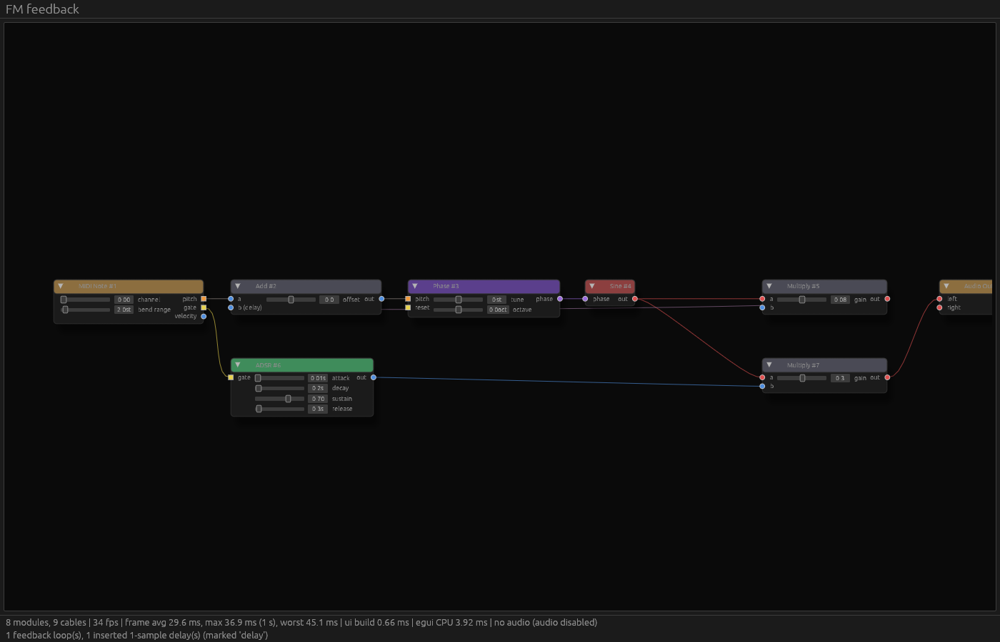

# Phase 0 UI Spikes

Two throwaway spikes answered ADR-0009's question: can a ready-made node editor carry LoomDSP's patch canvas? The outcome: Iced for the application UI, and our own canvas as an Iced widget ([ADR-0010](../adr/0010-own-patch-canvas.md)).

The spike code was removed from the repository after the decision. It is still in git history: the last commit containing it is `4b057de`. To look at it again:

```sh
git checkout 4b057de -- spikes/
```

The write-ups below are kept as they were, so the evidence behind the ADRs stays readable. Commands in them refer to the removed `spikes/` folder.

## Iced + iced_nodegraph

Phase 0 spike for [ADR-0009](../adr/0009-ui-stack-iced.md). The question: can Iced with `iced_nodegraph` carry LoomDSP's patching canvas?

This is throwaway code. It answers questions; it is not the start of the real UI.

It is a standalone Cargo project (not part of the main workspace), so its large GUI dependency tree does not slow down engine builds and CI.

### Run it

```sh
cd spikes/ui-nodegraph
cargo run --release -- ../../examples/patches/fm-feedback.ron     # plays through your audio device
cargo run --release -- --generate 100                             # 100-module stress graph
cargo run --release -- --generate 300
cargo run --release -- --generate 300 --no-audio
```

If a MIDI input is connected, it plays from your keyboard. Without one, use the **Hold note** button.

Controls: drag between pins to connect, click a connected pin to unplug, drag nodes to move, right-drag to pan, scroll to zoom, Delete to remove selected modules, Home to frame everything. **Save** writes `<patch>.saved.ron` with node positions.


### What it proves

| Question (ADR-0009) | Result |
|---|---|
| Typed, coloured ports and cables | Yes. Pins use the signal colours from ADR-0007. Cables are gradients from source to destination colour. Pitch and gate pins are square, others round, so type does not rely on colour alone (NFR-UX-03). |
| "Patch anything to anything" | Yes. `can_connect` only checks direction (output to input). |
| App owns the data model | Yes. The widget is stateless. The canvas renders straight from `Controller::graph()`, and every gesture becomes a `Controller` edit plus `commit()`. No duplicate model, which is what ADR-0005 wanted. |
| Live editing while audio plays | Yes. Connect, disconnect, and delete swap the engine schedule while audio keeps playing. |
| Show the compiler's view | Yes. Cables where the compiler inserted a 1-sample delay are drawn dashed, and the status line reports feedback loops. |
| Parameter controls inside nodes | Yes. Any Iced widget can live inside a node. The spike uses plain sliders. |
| Nested graphs, minimap, box select, delete, clone | Provided by `iced_nodegraph`. Minimap shown. Nesting not tried yet. |
| 300 nodes | Renders correctly. Canvas CPU work (layout, geometry, edges) measured **about 5.5 ms per frame** for 298 modules and 371 cables on a 2-vCPU cloud VM. |

### Still to measure on real hardware

The cloud VM has no GPU. It rendered with a software Vulkan driver at 2 to 7 fps, which says nothing about real performance. On the reference machine, record from the status bar:

| Graph | fps | worst frame | canvas CPU |
|---|---|---|---|
| fm-feedback.ron (8 modules, no audio) | 40 | 25.0 ms (worst 35.5) | 1.23 ms |
| --generate 100 | | | |
| --generate 300 | 22 to 24 | (not recorded: bug, fixed) | 4 to 10 ms |

Pass criterion (NFR-PERF-04): 60 fps with 300 modules visible.

**First result (2026-10-13, maintainer's Mac, audio on):** 22 to 24 fps with 298 modules. This fails the target. The canvas's own CPU work (4 to 10 ms) does not explain a frame time of about 43 ms, so the rest is spent elsewhere: Iced layout of the widgets inside nodes, GPU drawing, or both. Audio load was 22% (max 27%) with no overruns, on its own thread.

To find where the time goes, run these and compare (the status bar now also shows average frame time and view build time):

| Run | fps | frame avg | view build | canvas CPU |
|---|---|---|---|---|
| `--generate 300` | 24 | 42.6 ms (worst 60.3) | 0.61 ms | 4.64 ms |
| `--generate 300 --no-audio` | 24 | 42.6 ms (worst 53.9) | 0.32 ms | 3.30 ms |
| `--generate 300 --no-audio --plain` (no sliders) | 24 | 41.7 ms (worst 49.2) | 0.39 ms | 5.58 ms |

**Reading (2026-10-13):** audio and node widgets make no difference. Building the view (under 1 ms) and the canvas's CPU work (3 to 6 ms) account for a small part of the ~42 ms frame. A frame time fixed at about 1/24 s across very different workloads suggests a cap (display refresh, Low Power Mode, or ProMotion choosing 24 Hz) rather than a performance limit, or GPU-bound drawing at full Retina resolution. Next test: the 8-module `fm-feedback.ron` patch. If it also runs at 24 fps, the limit is not the graph size.

**8-module result:** 40 fps (25.0 ms). So there is no fixed 24 fps cap, but even a near-empty canvas misses 60 fps. Frame times match whole refreshes of a 120 Hz display (25.0 ms = 3 x 8.33 ms; 41.7 ms = 5 x 8.33 ms): the real work is about 17 to 25 ms for 8 modules and 34 to 42 ms for 300, then each frame waits for the next refresh. CPU-side work is small in both cases, so the likely cost is GPU drawing at Retina resolution (about 5 million pixels at 1400 x 900 points). The minimap adds a second rendering pass.

Next tests:

| Run | fps | frame avg |
|---|---|---|
| `--generate 300 --no-audio --no-minimap` | | |
| `--generate 300 --no-audio`, window shrunk to about a quarter of the area | | |
| iced_nodegraph's own `demo_500_nodes` on the same Mac | | |

If fps rises with a smaller window, drawing is fill-rate bound (cost per pixel), which is a question for iced_nodegraph's renderer. If its own demo is fast on the same machine, our usage is the difference.

### Profile (samply, `--generate 300 --no-audio`)

The CPU profile shows the main thread is busy on the CPU, not waiting on the GPU. The "canvas CPU" figure in the status bar misses most of this work. Main thread, share of samples:

| Share | Where |
|---|---|
| 24.5% | `iced_nodegraph::style::roles::Roles::of`, reached through `default_pin_style` in the spike's per-pin style closure. Mostly OKLab colour conversion (`to_oklab`, `from_oklab`, and `powf`/`cbrt` in `libsystem_m`). Runs for every pin, every frame. |
| 16.9% | Waiting for the next drawable from macOS (`get_current_texture`): frame pacing, not work. |
| 10.7% | `pin_cutout_params` (per-pin styling inside the library). |
| ~8% | Iced layout of the widgets inside nodes. |
| ~5% | Text layout (cosmic-text). |
| ~5% | Preparing the SDF primitive for the GPU. |
| ~2% | The Metal GPU driver itself. |

**Fix applied:** the spike now caches the theme-derived default pin and edge styles per status (`StyleCache`), instead of recomputing them for each of about 1,500 pins and 371 edges every frame.

**Profile after the fix** (main thread, same run):

| | Before | After |
|---|---|---|
| `Roles::of` (theme colours) | 24.5% | 4.0% |
| Maths library (`powf`, `cbrt`) | 17.0% | 2.9% |
| `pin_cutout_params` | 10.7% | 0.6% |
| Waiting for the next drawable | 16.9% | 19.0% |
| Memory allocation | 9.6% | 13.8% |
| Iced layout | about 8% | 7.7% |
| Text layout | about 5% | 5.3% |
| SDF primitive preparation | about 5% | 5.8% |

The remaining 4% in `Roles::of` comes from the library's own `default_node_style`. Allocation is spread across the node editor rebuilding its draw lists every frame (`draw_impl`, `SdfPrimitive::push`, dropping `DrawEntry` vectors), so there is no single fix on our side. Both are candidates for upstream improvements.

**Frame rate after the fix: still 22 to 24 fps.** The main thread's CPU work dropped by about a third, and the frame rate did not change. The main thread now waits about 45% of the time, mostly in `get_current_texture` (waiting for macOS to hand back a drawable). This points to GPU time as the limit, which a CPU profiler cannot see. The machine has an Apple M1-family GPU (`AGXMetalG13X` driver). The SDF renderer does work per pixel, which grows with Retina resolution and would also explain 40 fps with only 8 modules.

To confirm:

| Check | Result |
|---|---|
| `MTL_HUD_ENABLED=1`, `--generate 300 --no-audio`: GPU time per frame | |
| Same, window shrunk to about a quarter: fps | Over 100 fps at first, then steady around 60 fps |
| iced_nodegraph's `demo_500_nodes` on the same Mac: fps | |
| `--generate 2 --no-audio` (near-empty canvas), full window: fps | |
| `--generate 2 --no-audio --no-minimap`, full window: fps | |

**Reading:** frame rate scales with window area, so drawing is limited by GPU fill rate (cost per pixel), not by CPU work or module count. The 8-module result (40 fps at full size) suggests a large fixed cost per pixel even with little on screen: possibly the background grid, the minimap pass, or the per-pixel tile culling. The near-empty canvas runs above will separate those.

**Same window, different display (`--generate 300`):** 24 fps on the laptop's built-in Retina display, about 70 fps on the external monitor. The window has the same size in points, but Retina's 2x scale gives about 4 times as many physical pixels (about 2800 x 1800 versus 1400 x 900). This matches the quarter-size result and confirms that rendering cost follows physical pixels.

**What this means for ADR-0009 (open):**

- Iced itself is not the problem. The cost is in iced_nodegraph's SDF renderer on this GPU at Retina resolution.
- If a near-empty canvas cannot reach 60 fps at full size on an M1, report it upstream with these measurements and profiles. This is a reproducible issue that affects every user of the crate on similar hardware.
- Our own options, if upstream cannot help soon: turn off costly effects (minimap, shadows, gradient and animated cables), render the canvas below native resolution, or move the canvas to a triangle-based renderer (Iced's built-in canvas, or `egui-snarl`), whose cost per pixel is much lower.

**Upstream note:** `default_pin_style` and `default_edge_style` call `Roles::of(theme)` each time, and with the default styles (no custom closure) the library does the same per pin. Memoising `Roles::of` per theme inside iced_nodegraph would speed up every user of the crate. This is a good first upstream contribution (the project includes AI agent files, so AI-assisted pull requests look welcome).

If `--plain` reaches 60 fps, the cost is the widgets inside nodes, and the fix is in our node design (for example, draw parameter controls only for nodes on screen or at readable zoom). If `--plain` is still slow, the cost is in the canvas or its GPU path, and we should compare with the `500_nodes` demo in the iced_nodegraph repository and talk to its maintainer before accepting ADR-0009.

### Findings and follow-ups

- **Auto-layout matters.** Patches without saved positions need a layout that handles feedback loops. The spike uses layering with cycle breaking. The real editor should save positions in the patch (the format already supports `position`).
- **Parameter sliders are linear.** Cutoff needs a logarithmic mapping (FR-PANEL-04). This belongs in the LoomDSP widget crate, not in the node editor.
- **Live scopes are not in the spike.** The engine has no telemetry path yet (FR-VIS-02, P1). Drawing a scope is a custom Iced widget fed from a telemetry queue. Test it in P1 with 4 live scopes.
- **Plugin window embedding** (OQ-13) is untested. Iced runs through `winit`; plugins need to draw into a host window. Research when plugin export is scheduled (deferred).
- **Version pinning.** The spike pins `iced = 0.14` and `iced_nodegraph = 0.5`. Upgrade both together (OQ-14).

### Conclusion (2026-10-13)

- Iced performed well. Its own costs were small once the spike's per-pin styling was cached.
- iced_nodegraph is limited by GPU fill rate on Retina displays: 24 fps with 300 modules and 40 fps with 8, at full window size on the reference laptop.
- Decision: Iced is accepted for the application UI. The patch canvas will be our own Iced widget ([ADR-0010](../adr/0010-own-patch-canvas.md)), so we control rendering cost, look, and module views.
- The remaining check rows above were not needed for the decision.

## egui + egui-snarl

Comparison spike for [ADR-0009](../adr/0009-ui-stack-iced.md). It mirrors [spikes/ui-nodegraph](#iced--iced_nodegraph) (Iced + iced_nodegraph) as closely as the libraries allow: the same patch loader and 300-module generator, live engine edits, typed and coloured ports, parameter sliders, and the same stats line. Both render through wgpu (Metal on macOS) with vsync.

The question: does a renderer that tessellates shapes into triangles (egui) avoid the per-pixel GPU cost we measured in iced_nodegraph's signed-distance-field renderer on a Retina display?

Throwaway code, standalone Cargo project (not in the main workspace).

### Run it

```sh
cd spikes/ui-snarl
cargo run --release -- ../../examples/patches/fm-feedback.ron
cargo run --release -- --generate 300 --no-audio
cargo run --release -- --generate 300 --no-audio --plain   # nodes without sliders
```

Controls: drag between pins to connect, right-click a pin to unplug, drag nodes to move, drag the background to pan, scroll or pinch to zoom, right-click a node to remove it.

Differences from the Iced spike:
- egui-snarl keeps its own copy of the graph, so the spike mirrors every edit into both the snarl and the engine `Controller`.
- egui-snarl starts zoomed to fit the whole graph, so all 300 modules are on screen at once. The Iced spike showed only part of the graph.
- No dashed wires: inputs with an inserted 1-sample delay are labelled "(delay)".
- The stats line shows "ui build" (time in the app's `ui()` function) and "egui CPU" (eframe's own CPU time for the last frame, including tessellation).



### Results

Measure on the same Mac, same display, same window size as the Iced spike:

| Run | Display | fps | frame avg | ui build | egui CPU |
|---|---|---|---|---|---|
| fm-feedback.ron (no audio) | Laptop (Retina) | | | | |
| `--generate 300 --no-audio` | Laptop (Retina) | | | | |
| `--generate 300 --no-audio --plain` | Laptop (Retina) | | | | |
| `--generate 300 --no-audio` | External | | | | |

Early sign from a CPU-only VM (software rendering, not comparable in fps): with all 300 modules on screen, `ui()` took about 11 ms and egui's CPU time about 20 ms per frame. egui lays out every node every frame (immediate mode), so its cost is on the CPU side, the opposite of iced_nodegraph.

### Conclusion (2026-10-13)

Rejected on look before the real-hardware measurement: egui's stock widgets and spacing are far from the polish we want (the Bitwig Grid is the reference), and egui-snarl keeps its own copy of the graph, which fits our `Controller` poorly. The patch canvas will be our own Iced widget ([ADR-0010](../adr/0010-own-patch-canvas.md)). Whether triangle-based drawing avoids the per-pixel cost will be measured on that canvas's first prototype instead.
