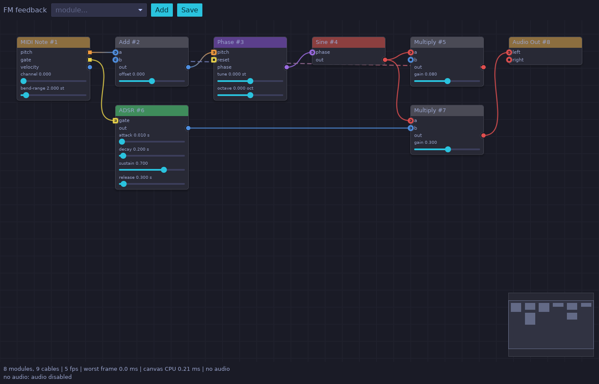
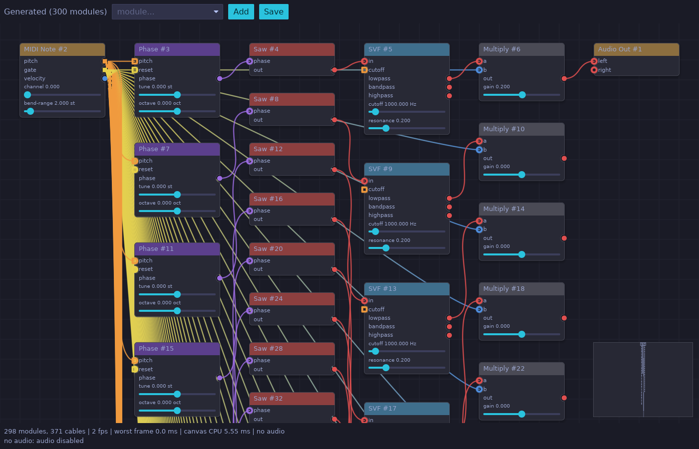

# UI spike: Iced + iced_nodegraph

Phase 0 spike for [ADR-0009](../../docs/adr/0009-ui-stack-iced.md). The question: can Iced with `iced_nodegraph` carry LoomDSP's patching canvas?

This is throwaway code. It answers questions; it is not the start of the real UI.

It is a standalone Cargo project (not part of the main workspace), so its large GUI dependency tree does not slow down engine builds and CI.

## Run it

```sh
cd spikes/ui-nodegraph
cargo run --release -- ../../examples/patches/fm-feedback.ron     # plays through your audio device
cargo run --release -- --generate 100                             # 100-module stress graph
cargo run --release -- --generate 300
cargo run --release -- --generate 300 --no-audio
```

If a MIDI input is connected, it plays from your keyboard. Without one, use the **Hold note** button.

Controls: drag between pins to connect, click a connected pin to unplug, drag nodes to move, right-drag to pan, scroll to zoom, Delete to remove selected modules, Home to frame everything. **Save** writes `<patch>.saved.ron` with node positions.





## What it proves

| Question (ADR-0009) | Result |
|---|---|
| Typed, coloured ports and cables | Yes. Pins use the signal colours from ADR-0007. Cables are gradients from source to destination colour. Pitch and gate pins are square, others round, so type does not rely on colour alone (NFR-UX-03). |
| "Patch anything to anything" | Yes. `can_connect` only checks direction (output to input). |
| App owns the data model | Yes. The widget is stateless. The canvas renders straight from `Controller::graph()`, and every gesture becomes a `Controller` edit plus `commit()`. No duplicate model, which is what ADR-0005 wanted. |
| Live editing while audio plays | Yes. Connect, disconnect, and delete swap the engine schedule while audio keeps playing. |
| Show the compiler's view | Yes. Cables where the compiler inserted a 1-sample delay are drawn dashed, and the status line reports feedback loops. |
| Parameter controls inside nodes | Yes. Any Iced widget can live inside a node. The spike uses plain sliders. |
| Nested graphs, minimap, box select, delete, clone | Provided by `iced_nodegraph`. Minimap shown. Nesting not tried yet. |
| 300 nodes | Renders correctly. Canvas CPU work (layout, geometry, edges) measured **about 5.5 ms per frame** for 298 modules and 371 cables on a 2-vCPU cloud VM. |

## Still to measure on real hardware

The cloud VM has no GPU. It rendered with a software Vulkan driver at 2 to 7 fps, which says nothing about real performance. On the reference machine, record from the status bar:

| Graph | fps | worst frame | canvas CPU |
|---|---|---|---|
| fm-feedback.ron (8 modules) | | | |
| --generate 100 | | | |
| --generate 300 | | | |

Pass criterion (NFR-PERF-04): 60 fps with 300 modules visible.

## Findings and follow-ups

- **Auto-layout matters.** Patches without saved positions need a layout that handles feedback loops. The spike uses layering with cycle breaking. The real editor should save positions in the patch (the format already supports `position`).
- **Parameter sliders are linear.** Cutoff needs a logarithmic mapping (FR-PANEL-04). This belongs in the LoomDSP widget crate, not in the node editor.
- **Live scopes are not in the spike.** The engine has no telemetry path yet (FR-VIS-02, P1). Drawing a scope is a custom Iced widget fed from a telemetry queue. Test it in P1 with 4 live scopes.
- **Plugin window embedding** (OQ-13) is untested. Iced runs through `winit`; plugins need to draw into a host window. Research before P3.
- **Version pinning.** The spike pins `iced = 0.14` and `iced_nodegraph = 0.5`. Upgrade both together (OQ-14).
